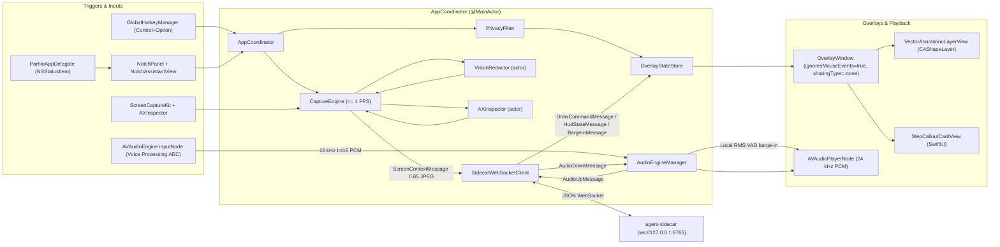

# Parhlo macOS Companion (`Parhlo` & `CompanionCore`) Architecture

`CompanionCore` (`macos-app/Packages/CompanionCore/`) is the native Swift 6 (`swift-tools-version: 6.0`, `.macOS(.v14)`+, Apple Silicon `arm64`) library powering `Parhlo.app` (`macos-app/Parhlo/`). It implements an accessory menu-bar and notch-pill AI companion with a click-through full-screen vector/SwiftUI overlay, privacy-first `<= 1 FPS` screen & accessibility capture with on-device Apple Vision redaction, full-duplex `AVAudioEngine` voice I/O with hardware echo cancellation, a global `Control+Option` (`⌃⌥`) hotkey, and a `URLSessionWebSocketTask` bridge to `agent-sidecar` on `ws://127.0.0.1:8765`.

---

## Module & Bundle Layout

| Group / Target | Files | Responsibility |
| :--- | :--- | :--- |
| `Parhlo` (App Target) | [`ParhloApp.swift`](Parhlo/ParhloApp.swift) | `@main` `ParhloAppDelegate` (`NSApplication.ActivationPolicy.accessory`), `NSStatusItem`, `NotchPanelWindowController`, dark `SettingsView` window |
| `App/` | [`AppCoordinator.swift`](Packages/CompanionCore/Sources/CompanionCore/App/AppCoordinator.swift), [`GlobalHotkeyManager.swift`](Packages/CompanionCore/Sources/CompanionCore/App/GlobalHotkeyManager.swift), [`SettingsView.swift`](Packages/CompanionCore/Sources/CompanionCore/App/SettingsView.swift) | Central `@MainActor` session orchestration, `Control+Option` modifier chord detector, 5-tab dark Preferences UI |
| `Models/` | [`WireModels.swift`](Packages/CompanionCore/Sources/CompanionCore/Models/WireModels.swift), [`OverlayModels.swift`](Packages/CompanionCore/Sources/CompanionCore/Models/OverlayModels.swift) | `Sendable`/`Codable` wire DTOs (`UpstreamMessage`, `DownstreamEvent`), coordinate conversion, hex color parsing |
| `Overlay/` | [`OverlayWindowController.swift`](Packages/CompanionCore/Sources/CompanionCore/Overlay/OverlayWindowController.swift), [`OverlayCanvasView.swift`](Packages/CompanionCore/Sources/CompanionCore/Overlay/OverlayCanvasView.swift), [`VectorAnnotationLayerView.swift`](Packages/CompanionCore/Sources/CompanionCore/Overlay/VectorAnnotationLayerView.swift), [`OverlayStateStore.swift`](Packages/CompanionCore/Sources/CompanionCore/Overlay/OverlayStateStore.swift), [`NotchPanelWindowController.swift`](Packages/CompanionCore/Sources/CompanionCore/Overlay/NotchPanelWindowController.swift), [`NotchAssistantView.swift`](Packages/CompanionCore/Sources/CompanionCore/Overlay/NotchAssistantView.swift) | Dual-window presentation (`OverlayWindow` click-through canvas + `NotchPanel` interactive drawer) and `@Observable` annotation state |
| `Capture/` | [`PrivacyFilter.swift`](Packages/CompanionCore/Sources/CompanionCore/Capture/PrivacyFilter.swift), [`CaptureEngine.swift`](Packages/CompanionCore/Sources/CompanionCore/Capture/CaptureEngine.swift), [`VisionRedactor.swift`](Packages/CompanionCore/Sources/CompanionCore/Capture/VisionRedactor.swift), [`AXInspector.swift`](Packages/CompanionCore/Sources/CompanionCore/Capture/AXInspector.swift) | Bundle-ID privacy pause, `SCContentFilter` self/app exclusion, off-main-actor OCR masking, `AXUIElement` traversal, `0.65` JPEG encoding |
| `Bridge/` | [`SidecarWebSocketClient.swift`](Packages/CompanionCore/Sources/CompanionCore/Bridge/SidecarWebSocketClient.swift) | `URLSessionWebSocketTask` client with exponential-backoff reconnect (`0.5s`–`16.0s`) and event dispatch |
| `Audio/` | [`AudioEngineManager.swift`](Packages/CompanionCore/Sources/CompanionCore/Audio/AudioEngineManager.swift), [`SpeechRecognitionManager.swift`](Packages/CompanionCore/Sources/CompanionCore/Audio/SpeechRecognitionManager.swift) | Full-duplex 16 kHz up / 24 kHz down `AVAudioEngine` + Voice Processing AEC + local RMS VAD; `SFSpeechRecognizer` wrapper |
| `Permissions/` | [`PermissionsManager.swift`](Packages/CompanionCore/Sources/CompanionCore/Permissions/PermissionsManager.swift), [`PermissionsOnboardingView.swift`](Packages/CompanionCore/Sources/CompanionCore/Permissions/PermissionsOnboardingView.swift) | TCC preflight/prompts and System Settings deep-links for Screen Recording, Accessibility, Microphone, and Speech Recognition |
| Bundle & Packaging | [`Package.swift`](Packages/CompanionCore/Package.swift), [`Info.plist`](Parhlo/Info.plist), [`Parhlo.entitlements`](Parhlo/Parhlo.entitlements), [`project.pbxproj`](Parhlo.xcodeproj/project.pbxproj) | Local SwiftPM package `CompanionCore` linked by `Parhlo.xcodeproj` (`Parhlo.xcworkspace`) for `com.parhlo.ScreenCompanionApp` signing and TCC persistence |

---

## High-Level System Architecture

---

## Dual-Window Overlay Model

Parhlo separates **non-blocking screen annotations** from **interactive assistant controls** using two independent borderless windows pinned at `NSWindow.Level.statusBar` with `[.canJoinAllSpaces, .fullScreenAuxiliary, .stationary]` and `sharingType = .none`:

1. **Full-Screen Click-Through Annotation Overlay ([`OverlayWindowController`](Overlay/OverlayWindowController.swift), [`OverlayCanvasView`](Overlay/OverlayCanvasView.swift), [`VectorAnnotationLayerView`](Overlay/VectorAnnotationLayerView.swift)):**
   - `OverlayWindow` subclasses `NSWindow` overriding `canBecomeKey` and `canBecomeMain` to return `false`.
   - Configured with `ignoresMouseEvents = true`, `isOpaque = false`, `backgroundColor = .clear`, `hasShadow = false`, and `sharingType = .none`.
   - Tracks `NSApplication.didChangeScreenParametersNotification` via `syncFrameToMainScreen()` to match `NSScreen.main`.
   - Hosts `OverlayCanvasView` inside an `NSHostingView`:
     - `VectorAnnotationLayerView` (`NSViewRepresentable` -> `VectorAnnotationNSView`): renders `highlights` and `arrows` in Core Animation `CAShapeLayer`s. Converts top-left wire coordinates (`PixelRect`, `Point2D`) to AppKit bottom-left coordinates using `CoordinateConverter.toAppKitLocalRect` / `toAppKitLocalPoint`. Highlights animate `strokeEnd` (`0.35s`) and optionally add an infinite `"pulse"` `CAKeyframeAnimation` ring (`style == "pulse"`); arrows draw quadratic Bezier shafts (`0.32s` `strokeEnd`) with angled arrowheads; removed annotations fade out over `0.18s`.
     - `StepCalloutCardView`: renders glassmorphic (`.ultraThinMaterial`) numbered step cards clamped inside the display bounds. (`CursorHUDView` is also defined in `OverlayCanvasView.swift`.)

2. **Interactive Top-Center Notch Pill & Drawer ([`NotchPanelWindowController`](Overlay/NotchPanelWindowController.swift), [`NotchAssistantView`](Overlay/NotchAssistantView.swift)):**
   - `NotchPanel` subclasses `NSPanel` with `[.borderless, .nonactivatingPanel]`, `hidesOnDeactivate = false`, `sharingType = .none`, and `canBecomeMain == false`.
   - Unlike `OverlayWindow`, `NotchPanel` toggles `allowKeyFocus` (`canBecomeKey { allowKeyFocus }`):
     - **Collapsed (`220 x 34`, `topOffset = 4`):** `allowKeyFocus = false`, displayed via `orderFrontRegardless()` as a dark camera-notch pill showing status dot, icon, and `hudState.displayTitle`.
     - **Expanded (`540 x 440`, `topOffset = 4`):** `setExpanded(true)` sets `allowKeyFocus = true`, calls `panel.makeKeyAndOrderFront(nil)` and `NSApp.activate(ignoringOtherApps: true)` so the user can switch between `.voice` and `.chat` tabs, type into the `"Ask Parhlo…"` composer dock, mute/trigger manual barge-in, launch demo annotations, or open `SettingsView`.

3. **Shared State Store ([`OverlayStateStore`](Overlay/OverlayStateStore.swift)):**
   - `@MainActor @Observable` store managing `hudState` (`idle`, `listening`, `thinking`, `drawing`, `privacyPaused`), `transcriptSnippet`, `highlights`, `arrows`, `callouts`, and `messages`.
   - `handleBargeIn(_:)` clears all active annotations and transitions `.drawing` to `.listening` (for `.vadInterrupted`) or `.idle` (for `.manual`).
   - `setPrivacyPaused(_:appName:)` saves `stateBeforePrivacyPause`, clears visible annotations, switches to `.privacyPaused`, and restores the prior state (mapping `.drawing` back to `.idle`) when the protected app loses focus.

---

## Privacy-First Capture Pipeline

Screen capture is strictly **on-demand during active sessions** (`<= 1 FPS`), never continuous background recording:

1. **Bundle-ID Exclusion & Focus Pausing ([`PrivacyFilter`](Capture/PrivacyFilter.swift)):**
   - Ships with `defaultExcludedBundleIDs` covering password managers (`com.apple.keychainaccess`, `com.apple.Passwords`, `com.1password.1password`, `com.agilebits.onepassword7`, `com.bitwarden.desktop`, `com.dashlane.dashlanephonefinal`).
   - Observes `NSWorkspace.didActivateApplicationNotification`; when a matching bundle ID becomes frontmost, sets `isPaused = true` and updates `OverlayStateStore.setPrivacyPaused(true, ...)`.
2. **Rate-Limited `ScreenCaptureKit` Snapshot ([`CaptureEngine`](Capture/CaptureEngine.swift)):**
   - `startSessionCapture(interval:)` clamps `effectiveInterval = max(1.0, interval)` (`minimumAllowedInterval = 1.0`), and `captureOnce(respectRateLimit: true)` enforces the 1-second cooldown via `lastCaptureDate` (`CaptureError.throttled`).
   - Evaluates `PrivacyFilter` **three times** around a capture: before `ScreenCaptureKit` capture, immediately after capture, and after OCR/AX inspection, throwing `CaptureError.privacyPaused` if a protected app gained focus mid-flight.
   - `captureDisplaySnapshot` queries `SCShareableContent.excludingDesktopWindows(false, onScreenWindowsOnly: true)`, filters `SCContentFilter(display:excludingApplications:exceptingWindows:)` to exclude Parhlo's own `ownPID` / `ownBundleID` (preventing feedback loops even on macOS 15+ where `sharingType = .none` alone can be bypassed) plus all apps in `excludedBundleIDs`, and captures a single frame via `SCScreenshotManager.captureImage` with `showsCursor = true` and `scalesToFit = true`.
3. **Concurrent On-Device OCR Redaction & Accessibility Inspection:**
   - **[`VisionRedactor`](Capture/VisionRedactor.swift) (`actor`):** Runs `VNRecognizeTextRequest` off `@MainActor` inside `Task.detached(priority: .userInitiated)` with `recognitionLevel = .accurate` and `usesLanguageCorrection = false` (preventing tokens/keys from being autocorrected). Matches `defaultPatterns` (Google/Gemini `AIza...`, OpenAI/Anthropic/Stripe `sk-/pk-/rk-`, GitHub `ghp_`/`github_pat_`, AWS `AKIA`, Slack `xox`, Google OAuth `ya29.`, Bearer tokens, labeled secret/API-key/password assignments, 15/16-digit credit cards, US SSNs) plus custom regexes. Computes character-range bounding boxes via `candidate.boundingBox(for: range)` (falling back to `observation.boundingBox`), pads by 4 px (`insetBy(dx: -4, dy: -4)`), and paints solid black masks in a `CGContext`.
   - **[`AXInspector`](Capture/AXInspector.swift) (`actor`):** Runs concurrently (`async let`) with `VisionRedactor`. Requires `AXIsProcessTrusted()`. Performs a breadth-first traversal of `AXUIElementCreateApplication(frontmostPID)` starting from `kAXFocusedWindowAttribute` and top-level children, capped at `maxDepth = 6`, `maxElements = 80`, and `maxTextLength = 120`. Drops zero-sized/off-screen frames (`isVisibleFrame`), suppresses `AXSecureTextField` `kAXValueAttribute` strings, and runs `VisionRedactor.containsSensitiveText` over `title`, `description`, and `value` (substituting `"[REDACTED]"` on match).
4. **JPEG Encoding & Upstream Dispatch:**
   - `CaptureEngine.buildContextMessage` / `encodeJPEG` encodes the redacted `CGImage` off `@MainActor` via `CGImageDestinationCreateWithData` (`UTType.jpeg`, `kCGImageDestinationLossyCompressionQuality = 0.65`) and base64-encodes it into `ScreenContextMessage`.

---

## Full-Duplex Audio, Hotkey & WebSocket Bridge

### Audio Pipeline ([`AudioEngineManager`](Audio/AudioEngineManager.swift), [`SpeechRecognitionManager`](Audio/SpeechRecognitionManager.swift))
- **Graph & Hardware AEC:** `AudioEngineManager.start()` attaches an `AVAudioPlayerNode` to `AVAudioEngine`'s `mainMixerNode` and enables hardware Acoustic Echo Cancellation via `inputNode.setVoiceProcessingEnabled(true)` (falling back to `isVoiceProcessingActive = false` if a virtual/hardware device rejects it).
- **16 kHz Upstream Capture:** Installs an input tap (`bufferSize: 1024`) on `inputNode`, converts from `hardwareInputFormat` to `16_000 Hz`, 1-channel interleaved `pcmFormatInt16` (`makePCMInt16Format`), and delivers raw PCM `Data` to `onAudioChunk`. `AppCoordinator` base64-encodes chunks into `AudioUpMessage` when `isSessionActive` and `webSocketClient.connectionState == .connected`.
- **Local VAD Pre-Filter:** Computes normalized RMS (`computePCM16RMS`) per tap buffer. When `localVADEnabled && isPlayingAudio && rms >= localVADThreshold` (`0.025`, debounced at `0.4s`), fires `onLocalVoiceActivity` so `AppCoordinator` immediately calls `stopPlaybackImmediately()`.
- **24 kHz Downstream Playback & Barge-In Flush:** `enqueuePlayback(pcm24kData:)` converts `24_000 Hz` Int16 mono PCM to `mainMixerNode`'s output format via `AVAudioConverter`, increments `activeScheduledBuffers`, and schedules playback with `.dataPlayedBack` completion tracking. `stopPlaybackImmediately()` resets counters and calls `playerNode.stop()` (+ `playerNode.play()` if running) to flush queued audio on local VAD, downstream `BargeInMessage`, or manual barge-in.
- **`SpeechRecognitionManager`:** Wraps `SFSpeechRecognizer` and `SFSpeechAudioBufferRecognitionRequest` (preferring `requiresOnDeviceRecognition = true` when supported) for live speech-to-text transcription.

### Global `Control+Option` (`⌃⌥`) Hotkey ([`GlobalHotkeyManager`](App/GlobalHotkeyManager.swift))
- Registers both `NSEvent.addGlobalMonitorForEvents(matching: .flagsChanged)` and `NSEvent.addLocalMonitorForEvents(matching: .flagsChanged)` so `Control+Option` works regardless of which application holds focus.
- Uses `ControlOptionChordDetector` (`isControlOptionChord` checks `[.control, .option, .command, .shift] == [.control, .option]`) with three `HotkeyActivationMode` options:
  - `.smartTapOrHold` (default, `holdThresholdSeconds = 0.35`): tapping toggles the session; holding `>= 0.35s` and releasing stops the session.
  - `.tapToToggle`: press toggles session on/off.
  - `.holdToSpeak`: press starts, release stops.

### WebSocket Bridge ([`SidecarWebSocketClient`](Bridge/SidecarWebSocketClient.swift))
- Connects to `ws://127.0.0.1:8765` using `URLSessionWebSocketTask` (`maximumMessageSize = 8 * 1024 * 1024`).
- Automatically reconnects while `shouldStayConnected` is `true` using `reconnectDelay(attempt:initialDelay:maxDelay:)` (`0.5s` initial, doubling up to `16.0s` cap).
- Decodes `DownstreamEvent` payloads and routes `.drawCommand`, `.hudState`, and `.bargeIn` to `OverlayStateStore` inside `withAnimation(.easeOut(duration: 0.18))`, while invoking `onBargeIn` and `onAudioDown` for `AppCoordinator` audio handling.

---

## TCC Permissions, Entitlements & Signing Persistence

macOS persists TCC grants by **bundle identifier** (`com.parhlo.ScreenCompanionApp`) and **code signature**. Because bare SwiftPM executables lack an `.app` bundle, `Info.plist`, and entitlements, [`Parhlo.xcodeproj`](Parhlo.xcodeproj/project.pbxproj) packages `ParhloApp.swift` + `CompanionCore` into `Parhlo.app` (`CODE_SIGN_STYLE = Automatic`, `SWIFT_STRICT_CONCURRENCY = complete`).

- **[`Info.plist`](Parhlo/Info.plist):**
  - `LSUIElement = true` (runs as a menu-bar accessory without a Dock icon).
  - `LSMinimumSystemVersion = 14.0`.
  - Usage descriptions: `NSMicrophoneUsageDescription`, `NSSpeechRecognitionUsageDescription`, `NSScreenCaptureUsageDescription`.
- **[`Parhlo.entitlements`](Parhlo/Parhlo.entitlements):**
  - `com.apple.security.app-sandbox = false` (required so `AXUIElement` can inspect third-party frontmost applications and global `.flagsChanged` event monitors observe modifier chords across apps).
  - `com.apple.security.device.audio-input = true` (allows microphone input under Hardened Runtime).
- **[`PermissionsManager`](Permissions/PermissionsManager.swift) & [`PermissionsOnboardingView`](Permissions/PermissionsOnboardingView.swift):**
  - Checks and prompts all four TCC gates (`allGranted` requires all four `.granted`) and opens the corresponding macOS System Settings panes:
    1. **Screen Recording:** `CGPreflightScreenCaptureAccess()` / `CGRequestScreenCaptureAccess()` (`Privacy_ScreenCapture`)
    2. **Accessibility:** `AXIsProcessTrusted()` / `AXIsProcessTrustedWithOptions(["AXTrustedCheckOptionPrompt": true])` (`Privacy_Accessibility`)
    3. **Microphone:** `AVCaptureDevice.authorizationStatus(for: .audio)` / `AVCaptureDevice.requestAccess(for: .audio)` (`Privacy_Microphone`)
    4. **Speech Recognition:** `SFSpeechRecognizer.authorizationStatus()` / `SFSpeechRecognizer.requestAuthorization` (`Privacy_SpeechRecognition`)
