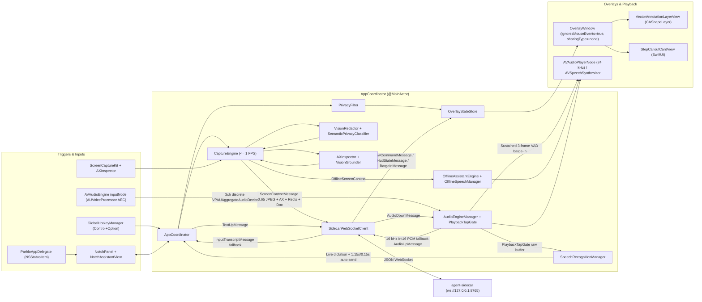

# Parhlo macOS Companion (`Parhlo` & `CompanionCore`) Architecture

`CompanionCore` (`macos-app/Packages/CompanionCore/`) is the native Swift 6 (`swift-tools-version: 6.0`, `.macOS(.v14)`+, Apple Silicon `arm64`) library powering `Parhlo.app` (`macos-app/Parhlo/`). It implements an accessory menu-bar and notch-pill AI companion with a click-through full-screen vector/SwiftUI overlay, privacy-first `<= 1 FPS` screen & accessibility capture with on-device Apple Vision redaction, semantic PII protection, sparse-AX Vision grounding, full-duplex `AVAudioEngine` voice I/O with hardware echo cancellation (`AUVoiceProcessor`) and `PlaybackTapGate` anti-feedback, live `SFSpeechRecognizer` dictation with `InputTranscriptMessage` sidecar fallback, on-device offline Q&A + TTS (`OfflineAssistantEngine`, `OfflineSpeechManager`), a global `Control+Option` (`⌃⌥`) hotkey, and a `URLSessionWebSocketTask` bridge to `agent-sidecar` on `ws://127.0.0.1:8765`.

---

## Module & Bundle Layout

| Group / Target | Files | Responsibility |
| :--- | :--- | :--- |
| `Parhlo` (App Target) | [`ParhloApp.swift`](Parhlo/ParhloApp.swift) | `@main` `ParhloAppDelegate` (`NSApplication.ActivationPolicy.accessory`), `NSStatusItem` left/right-click menu, `NotchPanelWindowController`, dark `SettingsView` window (`780 x 520`) that auto-minimizes the drawer on open |
| `App/` | [`AppCoordinator.swift`](Packages/CompanionCore/Sources/CompanionCore/App/AppCoordinator.swift), [`GlobalHotkeyManager.swift`](Packages/CompanionCore/Sources/CompanionCore/App/GlobalHotkeyManager.swift), [`OfflineAssistantEngine.swift`](Packages/CompanionCore/Sources/CompanionCore/App/OfflineAssistantEngine.swift), [`SettingsView.swift`](Packages/CompanionCore/Sources/CompanionCore/App/SettingsView.swift) | Central `@MainActor` session/dictation/fallback orchestration, `Control+Option` modifier chord detector, Phase 5 on-device Q&A (`OfflineAssistantEngine`, `AssistantBackendMode`), 5-tab dark Preferences UI |
| `Models/` | [`WireModels.swift`](Packages/CompanionCore/Sources/CompanionCore/Models/WireModels.swift), [`OverlayModels.swift`](Packages/CompanionCore/Sources/CompanionCore/Models/OverlayModels.swift) | `Sendable`/`Codable` wire DTOs (`UpstreamMessage`, `DownstreamEvent`, `DetectedRectBounds`, `DocumentContext`, `InputTranscriptMessage`), coordinate conversion, hex color parsing |
| `Overlay/` | [`OverlayWindowController.swift`](Packages/CompanionCore/Sources/CompanionCore/Overlay/OverlayWindowController.swift), [`OverlayCanvasView.swift`](Packages/CompanionCore/Sources/CompanionCore/Overlay/OverlayCanvasView.swift), [`VectorAnnotationLayerView.swift`](Packages/CompanionCore/Sources/CompanionCore/Overlay/VectorAnnotationLayerView.swift), [`OverlayStateStore.swift`](Packages/CompanionCore/Sources/CompanionCore/Overlay/OverlayStateStore.swift), [`NotchPanelWindowController.swift`](Packages/CompanionCore/Sources/CompanionCore/Overlay/NotchPanelWindowController.swift), [`NotchAssistantView.swift`](Packages/CompanionCore/Sources/CompanionCore/Overlay/NotchAssistantView.swift) | Dual-window presentation (`OverlayWindow` click-through canvas + `NotchPanel` hover/pin interactive drawer) and `@Observable` annotation, transcript, and chat state |
| `Capture/` | [`PrivacyFilter.swift`](Packages/CompanionCore/Sources/CompanionCore/Capture/PrivacyFilter.swift), [`CaptureEngine.swift`](Packages/CompanionCore/Sources/CompanionCore/Capture/CaptureEngine.swift), [`VisionRedactor.swift`](Packages/CompanionCore/Sources/CompanionCore/Capture/VisionRedactor.swift), [`SemanticPrivacyClassifier.swift`](Packages/CompanionCore/Sources/CompanionCore/Capture/SemanticPrivacyClassifier.swift), [`AXInspector.swift`](Packages/CompanionCore/Sources/CompanionCore/Capture/AXInspector.swift), [`VisionGrounder.swift`](Packages/CompanionCore/Sources/CompanionCore/Capture/VisionGrounder.swift) | Bundle-ID privacy pause, `SCContentFilter` self/app exclusion, off-main-actor OCR + semantic PII masking, `AXUIElement` traversal, sparse-AX rectangle & document grounding, `0.65` JPEG encoding |
| `Bridge/` | [`SidecarWebSocketClient.swift`](Packages/CompanionCore/Sources/CompanionCore/Bridge/SidecarWebSocketClient.swift) | `URLSessionWebSocketTask` client with exponential-backoff reconnect (`0.5s`–`16.0s`) and synchronous `@MainActor` event dispatch |
| `Audio/` | [`AudioEngineManager.swift`](Packages/CompanionCore/Sources/CompanionCore/Audio/AudioEngineManager.swift), [`SpeechRecognitionManager.swift`](Packages/CompanionCore/Sources/CompanionCore/Audio/SpeechRecognitionManager.swift), [`OfflineSpeechManager.swift`](Packages/CompanionCore/Sources/CompanionCore/Audio/OfflineSpeechManager.swift) | Full-duplex `16 kHz` up / `24 kHz` down `AVAudioEngine` + `AUVoiceProcessor` AEC + `PlaybackTapGate` anti-feedback; `SFSpeechRecognizer` 3ch discrete normalization & silence-timeout recovery; `AVSpeechSynthesizer` offline TTS |
| `Permissions/` | [`PermissionsManager.swift`](Packages/CompanionCore/Sources/CompanionCore/Permissions/PermissionsManager.swift), [`PermissionsOnboardingView.swift`](Packages/CompanionCore/Sources/CompanionCore/Permissions/PermissionsOnboardingView.swift) | TCC preflight/prompts and System Settings deep-links for Screen Recording, Accessibility, Microphone, and Speech Recognition |
| Bundle & Packaging | [`Package.swift`](Packages/CompanionCore/Package.swift), [`Info.plist`](Parhlo/Info.plist), [`Parhlo.entitlements`](Parhlo/Parhlo.entitlements), [`project.pbxproj`](Parhlo.xcodeproj/project.pbxproj) | Local SwiftPM package `CompanionCore` linked by `Parhlo.xcodeproj` (`Parhlo.xcworkspace`) for `com.parhlo.ScreenCompanionApp` signing and TCC persistence |

---

## High-Level System Architecture

---

## Dual-Window Overlay & Notch Drawer Model

Parhlo separates **non-blocking screen annotations** from **interactive assistant controls** using two independent borderless windows pinned at `NSWindow.Level.statusBar` with `[.canJoinAllSpaces, .fullScreenAuxiliary, .stationary]` and `sharingType = .none`:

1. **Full-Screen Click-Through Annotation Overlay ([`OverlayWindowController`](Packages/CompanionCore/Sources/CompanionCore/Overlay/OverlayWindowController.swift), [`OverlayCanvasView`](Packages/CompanionCore/Sources/CompanionCore/Overlay/OverlayCanvasView.swift), [`VectorAnnotationLayerView`](Packages/CompanionCore/Sources/CompanionCore/Overlay/VectorAnnotationLayerView.swift)):**
   - `OverlayWindow` subclasses `NSWindow` overriding `canBecomeKey` and `canBecomeMain` to return `false`.
   - Configured with `ignoresMouseEvents = true`, `isOpaque = false`, `backgroundColor = .clear`, `hasShadow = false`, and `sharingType = .none`.
   - Tracks `NSApplication.didChangeScreenParametersNotification` via `syncFrameToTargetScreen()`, supports display pinning (`syncFrame(to:)`, `syncFrame(toDisplayID:)`), and otherwise targets the cursor screen -> `NSScreen.main` -> first screen.
   - Hosts `OverlayCanvasView` inside an `NSHostingView`:
     - `VectorAnnotationLayerView` (`NSViewRepresentable` -> `VectorAnnotationNSView`): renders `highlights` and `arrows` in Core Animation `CAShapeLayer`s. Converts top-left wire coordinates (`PixelRect`, `Point2D`) to AppKit bottom-left coordinates using `CoordinateConverter.toAppKitLocalRect` / `toAppKitLocalPoint`. Highlights animate `strokeEnd` (`0.35s`) and add an infinite `1.8s` `"pulse"`/`"spotlight"` `CAKeyframeAnimation` halo anchored at the box center (`shouldShowPulseRing`); arrows draw quadratic Bezier shafts (`0.32s` `strokeEnd`) with angled arrowheads and synthesize a `~56.6 pt` (`40x40`) diagonal `resolvedArrowStartPoint` when `fromPoint` is `nil`; optional labels render as pill `CALayer` + `CATextLayer` tags; removed annotations fade out over `0.18s`.
     - `StepCalloutCardView`: renders glassmorphic (`.ultraThinMaterial`, width `300`) numbered step cards clamped inside display bounds (`CursorHUDView` is also defined in `OverlayCanvasView.swift`).
     - **Capture Edge Pulse:** `OverlayStateStore.triggerCapturePulse()` increments `capturePulseID`, triggering a `0.55s` non-hit-tested cyan/blue/green screen-edge shimmer in `OverlayCanvasView` whenever an on-demand screen frame is sent or inspected offline.

2. **Interactive Top-Center Notch Pill & Drawer ([`NotchPanelWindowController`](Packages/CompanionCore/Sources/CompanionCore/Overlay/NotchPanelWindowController.swift), [`NotchAssistantView`](Packages/CompanionCore/Sources/CompanionCore/Overlay/NotchAssistantView.swift), [`ParhloApp.swift`](Parhlo/ParhloApp.swift)):**
   - `NotchPanel` subclasses `NSPanel` with `[.borderless, .nonactivatingPanel]`, `hidesOnDeactivate = false`, `sharingType = .none`, `canBecomeMain == false`, and `canBecomeKey { allowKeyFocus }`.
   - **Collapsed Pill (`220 x 34`, `topOffset = 4`):** `allowKeyFocus = false`, displayed via `orderFrontRegardless()` as a dark notch capsule with live mic-reactive status dot, icon, `"Parhlo"`, and status text (`Privacy Paused`, `Listening…`, or `hudState.displayTitle`).
   - **Expanded Drawer (`540 x 440`, `topOffset = 4`):** Hosts `NotchAssistantView` with `.voice` and `.chat` (`AssistantDrawerTab`) tabs (defaulting to `.chat` and auto-switching to `.chat` when `dictationText` becomes non-empty), live `MicActivityMeterView`, the `"Ask Parhlo…"` composer dock (`TextField` bound to `$overlayStore.dictationText`, mute/barge-in button, `+` menu, send button), Demo Annotations button, Settings gear button, and Collapse button.
   - **Hover-to-Expand:** Global + local `.mouseMoved` monitors and `NotchHoverTrackingView` (`NSTrackingArea`) detect cursor entry into the top-center notch strip (`isPointInTopTriggerZone`: within `38 pt` of `screenFrame.maxY` and `|x - midX| <= 150 pt` across connected displays) and expand non-activating (`openedViaHover = true`, `setExpanded(true, activateApp: false)`), so the active third-party app keeps focus. Moving outside both the top trigger strip and the drawer (`isPointInsideExpandedDrawer` with a `16 pt` grace margin) schedules a `450ms` `hoverCollapseTask` to collapse unless pinned, actively editing (`isEditingPrompt`), or in an active session (`isSessionActive`).
   - **Click-to-Pin:** A local `.leftMouseDown` monitor for `panel.windowNumber`, tapping the `"Ask Parhlo…"` input field, or focusing the prompt (`isPromptFocused`) invokes `pinAndActivateForInteraction()`, clearing `openedViaHover`, cancelling `hoverCollapseTask`, calling `panel.makeKeyAndOrderFront(nil)`, and activating the app (`NSApp.activate(ignoringOtherApps: true)`).
   - **Automatic Minimization on Opening Settings:** Clicking the drawer's gear button (`NotchPanelWindowController.handleOpenSettingsFromDrawer()`) or selecting Settings from the menu bar (`ParhloAppDelegate.openSettingsWindow()`) calls `setExpanded(false, activateApp: false)` so the drawer collapses back to the notch pill before opening the dark `SettingsView` window (`780 x 520`).

3. **Shared State Store ([`OverlayStateStore`](Packages/CompanionCore/Sources/CompanionCore/Overlay/OverlayStateStore.swift)):**
   - `@MainActor @Observable` store managing `hudState` (`idle`, `listening`, `thinking`, `drawing`, `privacyPaused`), `transcriptSnippet`, `dictationText`, `isEditingPrompt`, `capturePulseID`, `highlights`, `arrows`, `callouts`, and `messages` (`ChatMessage`).
   - `appendToLastAssistantMessage(_:)` coalesces streaming assistant transcript deltas into the active assistant bubble without duplicating trailing suffixes.
   - `handleBargeIn(_:)` clears all active annotations and transitions `.drawing` to `.listening` (for `.vadInterrupted`) or `.idle` (for `.manual`).
   - `setPrivacyPaused(_:appName:)` saves `stateBeforePrivacyPause`, clears visible annotations, switches to `.privacyPaused`, and restores the prior state (mapping `.drawing` back to `.idle`) when the protected app loses focus.

---

## Privacy-First Capture & Phase 5 Native Intelligence Pipeline

Screen capture is strictly **on-demand** (`<= 1 FPS`), never continuous background recording:

1. **Bundle-ID Exclusion & Focus Pausing ([`PrivacyFilter`](Packages/CompanionCore/Sources/CompanionCore/Capture/PrivacyFilter.swift)):**
   - Ships with `defaultExcludedBundleIDs` covering password managers (`com.apple.keychainaccess`, `com.apple.Passwords`, `com.1password.1password`, `com.agilebits.onepassword7`, `com.bitwarden.desktop`, `com.dashlane.dashlanephonefinal`).
   - Observes `NSWorkspace.didActivateApplicationNotification`; ignores Parhlo self-activation (`ownBundleID`) so an active privacy pause for an underlying protected app stays intact when interacting with the Notch Drawer or Settings, and pauses/resumes `OverlayStateStore` + `AppCoordinator` capture whenever a protected app gains/loses focus.

2. **Rate-Limited `ScreenCaptureKit` Snapshot ([`CaptureEngine`](Packages/CompanionCore/Sources/CompanionCore/Capture/CaptureEngine.swift)):**
   - `startSessionCapture(interval:)` clamps `effectiveInterval = max(1.0, interval)` (`minimumAllowedInterval = 1.0`), and `captureOnce(respectRateLimit: true)` enforces the 1-second cooldown and `isCaptureInFlight` guard (`CaptureError.throttled`).
   - Evaluates `PrivacyFilter` **three times** around capture (`evaluateLivePrivacyAndResolveTarget` before `ScreenCaptureKit`, plus `verifyLivePrivacy` after snapshot and before returning), throwing `CaptureError.privacyPaused` if a protected app activates mid-flight.
   - `captureDisplaySnapshot` queries `SCShareableContent`, selects the target display via `selectDisplayID` (frontmost window overlap > cursor display > `NSScreen.main` > first), excludes Parhlo's own `ownPID`/`ownBundleID` plus all `excludedBundleIDs` via `SCContentFilter(display:excludingApplications:exceptingWindows:)`, and captures one frame via `SCScreenshotManager.captureImage` (`showsCursor = true`, `scalesToFit = true`).
   - Also exposes `captureOfflineContext()` returning an `OfflineScreenContext` (`sanitizedOCRText`, `axElements`, frontmost bundle/app metadata) without JPEG encoding for offline Q&A.

3. **On-Device OCR Redaction & Semantic PII Protection ([`VisionRedactor`](Packages/CompanionCore/Sources/CompanionCore/Capture/VisionRedactor.swift), [`SemanticPrivacyClassifier`](Packages/CompanionCore/Sources/CompanionCore/Capture/SemanticPrivacyClassifier.swift)):**
   - **`VisionRedactor` (`actor`):** Runs `VNRecognizeTextRequest` off `@MainActor` in `Task.detached(priority: .userInitiated)` with `recognitionLevel = .accurate`, `usesLanguageCorrection = false` (preventing token/key alteration), and `preferCPUOnly = true` (pinning `MLComputeDevice` `.cpu`). Matches `defaultPatterns` (Google/Gemini `AIza...`, OpenAI/Anthropic/Stripe `sk-/pk-/rk-`, GitHub `ghp_`/`github_pat_`, AWS `AKIA`, Slack `xox`, Google OAuth `ya29.`, Bearer tokens, labeled secret assignments, passwords, 15/16-digit credit cards, US SSNs) plus custom regexes, pads character/line bounding boxes by `4 px` (`insetBy(dx: -4, dy: -4)`), and paints solid black masks in a `CGContext`. Fails closed by masking the full frame bounds if Vision OCR throws. Also provides `redactSensitiveText(_:)` and `sanitizedOCRText`.
   - **`SemanticPrivacyClassifier.swift`:** Adds `SemanticPIIClassifying`, a bounded 512-entry LRU `SemanticPIICache` actor (`normalize(_:)`), and `HeuristicSemanticPIIClassifier` (`DefaultSemanticPIIClassifier`) detecting contextual PINs/OTPs/2FA/CVV codes, natural-language password/secret disclosures, recovery/seed phrases and mnemonic word lists (`looksLikeMnemonicSeedLine`), IBAN/routing/account/SSN/tax/passport/driver-license identifiers, PEM private key blocks, and credentialed database URIs—with optional macOS 26+ `FoundationModels` (`SystemLanguageModel`) classification (`useFoundationModelsIfAvailable`). When enabled via `VisionRedactor.setSemanticPrivacy(enabled:classifier:)`, unmatched OCR lines are classified asynchronously under a `400ms` timeout (`classifyWithTimeout`) and black-masked alongside regex hits.

4. **Accessibility Inspection & Sparse-AX Vision Grounding ([`AXInspector`](Packages/CompanionCore/Sources/CompanionCore/Capture/AXInspector.swift), [`VisionGrounder`](Packages/CompanionCore/Sources/CompanionCore/Capture/VisionGrounder.swift)):**
   - **`AXInspector` (`actor`):** Runs concurrently (`async let`) with `VisionRedactor`. Requires `AXIsProcessTrusted()`. Performs BFS over `AXUIElementCreateApplication(targetPID)` (`maxDepth = 6`, `maxElements = 80`, `maxTextLength = 120`), drops off-screen/zero-sized elements (`isVisibleFrame`), converts coordinates to display-local top-left bounds (`displayLocalRect`), suppresses `AXSecureTextField` values, and redacts sensitive attribute strings via `VisionRedactor`. Exposes `isSparseTree(_:)`, returning `true` when empty or fewer than `4` non-container elements exist.
   - **`VisionGrounder` (`actor`):**
     - **Rectangle Fallback (`detectRectangles`):** Whenever `AXInspector.isSparseTree(elements)` is `true` (e.g., canvas/Electron/game/media UIs), runs `VNDetectRectanglesRequest` on CPU (`maxCount = 30`, minimum `12 x 12 px`, `<= 90%` screen area, sorted by confidence) and converts Vision bottom-left normalized boxes into top-left `DetectedRectBounds`.
     - **Structured Document Context (`extractDocumentContext`):** Builds a redacted `DocumentContext` (`maxTotalChars = 4000`) from `sanitizedOCRText` by default (avoiding redundant full-frame Vision passes and E5 ANE bundle warnings), or runs macOS 26+ `RecognizeDocumentsRequest` (`title`, up to `12` paragraphs / `2` tables / `12` rows / `8` cells in `VisionGrounder`) when `useStructuredVisionRequest` is enabled.
   - `CaptureEngine.buildContextMessage` / `encodeJPEG` encodes the redacted `CGImage` (`UTType.jpeg`, quality `0.65`) into `ScreenContextMessage` alongside `axElements`, `detectedRects`, and `documentContext`.

5. **On-Device Offline Assistant & TTS ([`OfflineAssistantEngine`](Packages/CompanionCore/Sources/CompanionCore/App/OfflineAssistantEngine.swift), [`OfflineSpeechManager`](Packages/CompanionCore/Sources/CompanionCore/Audio/OfflineSpeechManager.swift)):**
   - `AssistantBackendMode` supports `.auto` (default), `.offlineOnly`, and `.sidecarOnly`.
   - When `.offlineOnly` is active, or when `.auto` cannot reach `agent-sidecar` within `2.0s` (`20 x 100ms`) or transmission fails, `AppCoordinator.runOfflineFallback(for:)` captures an on-device `OfflineScreenContext` and calls `OfflineAssistantEngine.answer(prompt:context:)`.
   - On macOS 26+ when Apple Intelligence (`SystemLanguageModel.default.isAvailable`) is ready, `OfflineAssistantEngine` prompts `LanguageModelSession` with the active app, up to `25` AX elements, and sanitized OCR text; otherwise (or on macOS 14–15) it generates a grounded response via `buildDeterministicSummary(prompt:context:)` using keyword-matched AX controls and OCR lines.
   - When no live voice session is active and output is unmuted, `OfflineSpeechManager` speaks the offline reply via `AVSpeechSynthesizer` with `utteranceGeneration` tracking (`SpeechSynthesizerDelegateProxy`) and instant `.immediate` barge-in cancellation.

---

## Full-Duplex Audio, Speech Recognition, Anti-Feedback & Fallback Pipeline

### Audio Graph, Hardware AEC & `PlaybackTapGate` ([`AudioEngineManager`](Packages/CompanionCore/Sources/CompanionCore/Audio/AudioEngineManager.swift))
- **Dedicated Serial Queue & Hardware AEC (`AUVoiceProcessor`):** `AudioGraphWorker` manages `AVAudioEngine` and `AVAudioPlayerNode` on a `.default` QoS serial `DispatchQueue` (`com.parhlo.audio-engine`) so `@MainActor` never blocks on CoreAudio HAL threads. `inputNode.setVoiceProcessingEnabled(true)` (`isVoiceProcessingBypassed = false`, `isVoiceProcessingAGCEnabled = true`) is configured before connecting `playerNode` to `mainMixerNode` (avoiding `-10877` / `2003332927`). A `1400ms` tap-delivery watchdog (`1500ms` for standard capture) automatically falls back to non-voice-processing capture (`fellBackToStandardCapture`) if CoreAudio HAL fails to deliver input buffers.
- **Discrete 3-Channel Extraction & 16 kHz / 24 kHz Conversion:** `convertToPCMInt16Data` extracts channel 0 directly when `channelCount > 2` or `isDiscreteOrUnspecifiedLayout` (e.g., 3-channel `VPAUAggregateAudioDevice`) where `AVAudioConverter` lacks a downmix matrix or zeroes unmapped discrete channels, converting to `16_000 Hz`, 1-channel interleaved `Int16` PCM (`makePCMInt16Format`). `enqueuePlayback(pcm24kData:)` converts `24_000 Hz` Int16 mono PCM into `mainMixerNode`'s output format and schedules buffers with `playbackGeneration` / `playbackToken` tracking.
- **`PlaybackTapGate` Anti-Feedback:** Synchronized via `OSAllocatedUnfairLock` on the input tap:
  - While assistant playback is active (`isPlaying == true`), raw mic buffers are **blocked** from `SpeechRecognitionManager` unless `vadEnabled && voiceProcessingActive` AND normalized RMS (`computePCM16RMS`) stays `>= localVADThreshold` (`0.065`) for `consecutiveVADFramesRequired` (`3`) consecutive frames. Without hardware AEC (`!isVoiceProcessingActive`), speaker playback never unlocks raw buffers or triggers local barge-in.
  - On 3 sustained `>= 0.065` frames with AEC active, `PlaybackTapGate` unlocks `forwardRawBuffer` and triggers `onLocalVoiceActivity` (debounced at `0.4s`), flushing `AVAudioPlayerNode` via `stopPlaybackImmediately()`, clearing annotations (`BargeInMessage(reason: .vadInterrupted)`), and sending `SessionControlMessage(action: .bargeInManual)` to the sidecar without wiping the newly captured user speech buffers.
  - When normal playback finishes, `PlaybackTapGate` enforces a **`350ms` post-playback tail holdoff** (`postPlaybackHoldoffSeconds = 0.35`) before forwarding raw audio buffers to `SpeechRecognitionManager`, preventing speaker/room decay tail from transcribing as user speech.

### Live Speech-to-Text, Echo Filtering & Sidecar Fallback ([`SpeechRecognitionManager`](Packages/CompanionCore/Sources/CompanionCore/Audio/SpeechRecognitionManager.swift), [`AppCoordinator`](Packages/CompanionCore/Sources/CompanionCore/App/AppCoordinator.swift))
- **3-Channel `VPAUAggregateAudioDevice` Normalization (`SpeechRecognitionManager`):** `normalizeBufferForSpeech` detects `channelCount > 2` or discrete/bitmap channel layouts (`isDiscreteChannelLayout`) and calls `extractMonoFloat32Buffer` to extract a clean 1-channel `Float32` buffer (choosing channel 0 when non-silent, or scanning channels `1..<channelCount` for the first non-silent signal `> 1e-6`) before appending synchronously to `SFSpeechAudioBufferRecognitionRequest` (preferring `requiresOnDeviceRecognition = true` when supported, with automatic non-on-device fallback if on-device initialization fails before producing text).
- **Silence-Timeout & Recoverable Error Recovery (`SpeechRecognitionManager`):** While `shouldRemainListening` is `true`, commits finished segments into `committedTranscriptPrefix` across Apple Speech `isFinal` boundaries and restarts seamlessly on recoverable silence/timeout errors (`kAFAssistantErrorDomain` codes `1110`, `203`, `216`, `1101`, `1107`, `kLSRErrorDomain` code `301`, or `"no speech"` / `"retry"` / `"cancel"` / `"timed out"` descriptions, waiting `250ms` on recoverable errors and `120ms` up to `maxConsecutiveRestartErrors = 5` on transient errors).
- **Live `"Ask Parhlo…"` Dictation & `1.15s` / `0.15s` Auto-Send (`AppCoordinator`):**
  - `handleLiveSpeechTranscript(_:isFinal:)` ignores updates while `audioManager.isPlayingAudio` is `true` and applies **`2.5s` assistant-echo filtering** (`isLikelyAssistantEcho`: suppresses normalized transcripts of `>= 6` characters or `>= 2` words that match a substring of `recentAssistantNormalizedText` within `2.5s` of assistant speech/playback activity, clearing unedited `dictationText` and resetting the recognizer).
  - Valid speech streams live into `overlayStore.dictationText` (`Ask Parhlo…`) via `applyLiveDictationTranscript` without overwriting manual user edits (`isEditingPrompt` with diverged text).
  - `scheduleSpeechAutoSend` automatically dispatches `sendTextPrompt` (`TextUpMessage` or offline fallback) **`1.15s`** (`speechStopAutoSendDelay`) after speech stops on partial transcripts—dynamically extended on sustained `>= 0.065` speech energy up to `2.2s` (`maxSpeechEnergyExtensionDelay`) from `lastTranscriptChangedAt`—or **`0.15s`** (`finalTranscriptAutoSendDelay`) once `isFinal == true`. Stopping a session flushes pending unedited dictation.
- **`InputTranscriptMessage` Sidecar Fallback:** If `SpeechRecognitionManager` is denied/unavailable or fails (`isUsingSidecarAudioFallback = true`), `AppCoordinator`'s bounded `AsyncStream` (`bufferingNewest(64)`) streams 16 kHz PCM `AudioUpMessage` chunks to `agent-sidecar`, and incoming `InputTranscriptMessage` events (`handleFallbackInputTranscript`) populate `"Ask Parhlo…"` and commit into user chat bubbles on `isFinal`, assistant reply start, or session stop.

### Global `Control+Option` (`⌃⌥`) Hotkey ([`GlobalHotkeyManager`](Packages/CompanionCore/Sources/CompanionCore/App/GlobalHotkeyManager.swift))
- Registers both `NSEvent.addGlobalMonitorForEvents(matching: .flagsChanged)` and `NSEvent.addLocalMonitorForEvents(matching: .flagsChanged)` so `Control+Option` works regardless of which application holds focus.
- Uses `ControlOptionChordDetector` (`isControlOptionChord` checks `[.control, .option, .command, .shift] == [.control, .option]`, rolling back accidental starts if `Command`/`Shift` escalates within `0.25s`) with three `HotkeyActivationMode` options:
  - `.smartTapOrHold` (default, `holdThresholdSeconds = 0.35`): tapping toggles the session; holding `>= 0.35s` and releasing stops the session.
  - `.tapToToggle`: press toggles session on/off.
  - `.holdToSpeak`: press starts, release stops.

### WebSocket Bridge ([`SidecarWebSocketClient`](Packages/CompanionCore/Sources/CompanionCore/Bridge/SidecarWebSocketClient.swift))
- Connects to `ws://127.0.0.1:8765` using `URLSessionWebSocketTask` (`maximumMessageSize = 8 * 1024 * 1024`) and invalidates the `URLSession` in `deinit`.
- Automatically reconnects while `shouldStayConnected` is `true` using `reconnectDelay(attempt:initialDelay:maxDelay:)` (`0.5s` initial, doubling up to `16.0s` cap).
- Decodes `DownstreamEvent` payloads and routes `.drawCommand`, `.hudState`, and `.bargeIn` to `OverlayStateStore` inside `withAnimation(.easeOut(duration: 0.18))`, while synchronously invoking `@MainActor` callbacks `onBargeIn`, `onAudioDown`, and `onInputTranscript` in arrival order for `AppCoordinator`.

---

## TCC Permissions, Entitlements & Signing Persistence

macOS persists TCC grants by **bundle identifier** (`com.parhlo.ScreenCompanionApp`) and **code signature**. Because bare SwiftPM executables lack an `.app` bundle, `Info.plist`, and entitlements, [`Parhlo.xcodeproj`](Parhlo.xcodeproj/project.pbxproj) packages `ParhloApp.swift` + `CompanionCore` into `Parhlo.app` (`CODE_SIGN_STYLE = Automatic`, `SWIFT_STRICT_CONCURRENCY = complete`).

- **[`Info.plist`](Parhlo/Info.plist):**
  - `LSUIElement = true` (runs as a menu-bar accessory without a Dock icon).
  - `LSMinimumSystemVersion = 14.0`.
  - Usage descriptions: `NSMicrophoneUsageDescription`, `NSSpeechRecognitionUsageDescription`, `NSScreenCaptureUsageDescription`.
- **[`Parhlo.entitlements`](Parhlo/Parhlo.entitlements):**
  - `com.apple.security.app-sandbox = false` (required so `AXUIElement` can inspect third-party frontmost applications and global `.flagsChanged` event monitors observe modifier chords across apps).
  - `com.apple.security.device.audio-input = true` (allows microphone input under Hardened Runtime).
- **[`PermissionsManager`](Packages/CompanionCore/Sources/CompanionCore/Permissions/PermissionsManager.swift) & [`PermissionsOnboardingView`](Packages/CompanionCore/Sources/CompanionCore/Permissions/PermissionsOnboardingView.swift):**
  - Checks and prompts all four TCC gates (`allGranted` requires all four `.granted`) and opens the corresponding macOS System Settings panes:
    1. **Screen Recording:** `CGPreflightScreenCaptureAccess()` / `CGRequestScreenCaptureAccess()` (`Privacy_ScreenCapture`)
    2. **Accessibility:** `AXIsProcessTrusted()` / `AXIsProcessTrustedWithOptions(["AXTrustedCheckOptionPrompt": true])` (`Privacy_Accessibility`)
    3. **Microphone:** `AVCaptureDevice.authorizationStatus(for: .audio)` / `AVCaptureDevice.requestAccess(for: .audio)` (`Privacy_Microphone`)
    4. **Speech Recognition:** `SFSpeechRecognizer.authorizationStatus()` / `SFSpeechRecognizer.requestAuthorization` (`Privacy_SpeechRecognition`)
